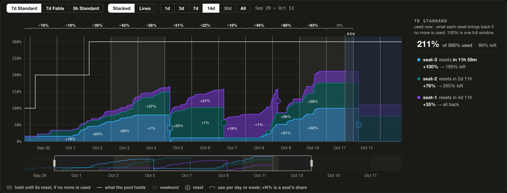
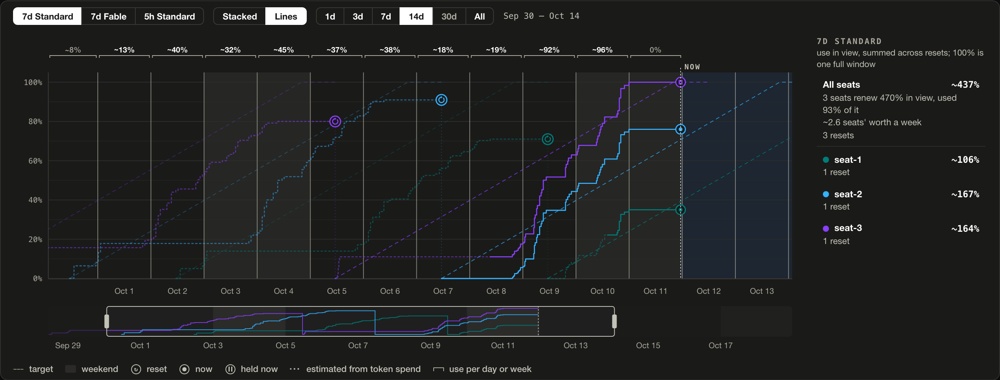

# Status page

The Management Center gains a "Claude Seat Pacer" entry: a live dashboard of
what the plugin decides and the numbers behind it. The page calls a seat's
plan its target, and ranks the eligible seats by cost: the weighted gap to
target, negative while a seat is behind, so the lowest cost takes the next new
conversation, except that an eligible seat with no weekly cap on the requested
model ranks ahead of every seat with one. While such a seat is eligible on the
serving tier, the ranking splits under "no weekly cap", "weekly cap" and "held
off" headings. A seat held off ranks below the eligible seats, including one
the host has disabled ("host disabled") or holds in a cooldown that covers
every model ("held by host", with the time the host lets it back). A seat
whose served models the host cools on their own keeps its rank, since the host
still offers it for other models, and its tooltip names the host status.

- **Next pick.** The bar across the top names the eligible seat the next new
  conversation lands on, for Standard requests and for each model family with
  a weekly window of its own, or that no seat is eligible, with the reason
  when the seats on the tier taking requests, or every seat while no tier
  can, share one. It shows how many seats are eligible on each family's tier
  taking requests and the age of the newest reading, and its Sync now button
  reads every seat at once; once it finishes, the next scheduled read is timed
  from it.
- **Seats.** Each seat's windows as bars, the weekly ones against their plan,
  with the gap to target and the time to reset, beside a two-week time axis
  showing each window's current cycle. A window holding its seat off, full or
  refused, is hatched red and marked with a pause, and that seat's other
  windows turn grey, as every window of a seat the host holds does.
  When seats differ in `priority`, the page groups them by tier, marks the
  tier taking requests as serving, and ranks only its seats. A tier below it
  is marked fallback, and a tier none of whose seats can take requests is
  skipped, with the reason: disabled in the host, held by host, refused by
  the provider, full, or not scored.
- **Current window.** Each seat's use of its current window against the curve,
  one window at a time: 7d Standard, each model family's 7-day cap the cost
  weighs, and 5h Standard. A 7-day view lists the seats in its family's
  ranking order, each with where it is headed at its last 24 hours' rate; the
  5-hour view shows where each seat stands against the limit that can make it
  ineligible. Pointing at a seat shows its gap to the target where the window
  is paced. A stretch in which the provider refused the seat, or a window
  bearing on the line read full, is a hatched sleeve in the seat's colour
  around its line, under every seat still taking work: a full seat takes no
  new conversation, so the provider may never be asked to refuse it. A seat
  held now (refused, full or held by host) has a pause in place of its mark's
  dot, and one the host has disabled a cross.
- **Over time.** One window across the recorded cycles, counting every seat in
  the pool whatever its priority tier. Stacked, the default, piles the seats'
  use into the pool's total against what the pool holds, one full window per
  seat able to spend it, strikes through each seat's refused or full
  stretches, and runs past now to show what comes back at each reset if no
  more is used. Lines draws each seat's use, with each refused or full stretch
  sleeved as on Current window and what ended it, and its side list totals the
  pool's use in seats' worth a week. Both shade the stretches in which every
  seat was refused or full at once, and mark each reset with ↻. On a weekly
  window, brackets over the plot give the pool's use per local day, or per
  week from Monday once days are too narrow to label, and each bracket's
  tooltip sets that against what the pool renews and splits it by seat. If
  every seat is on the same plan, these figures show whether the pool has
  enough seats, though use understates demand while every seat is refused or
  full.

  

  

- **Bindings.** The conversations held on each seat.
- **Routing log.** The recent decisions, newest first. Each new pick and each
  move opens to show every seat's cost at that moment.

A seat you hide with the eye beside its name leaves every view, the bindings
and the routing log included, and stays hidden in that browser. A seat the host
has disabled is hidden the same way and returns once the host enables it.
`N hidden · show` under the seats draws every seat again. It shows the
disabled ones only until the page reloads, and never in Over time. Hiding
changes only the page; routing is unchanged.

A warning banner names anything that leaves the plugin inert or degraded, such
as a seat alone on the top priority tier, a seat not read yet, a failing
usage poll, or a seat the host keeps cooled after its quota came back.

The page names a window by its length and the requests it gates. `5h Standard`
and `7d Standard` are the 5-hour and all-models weekly windows, which apply to
every request; `7d Fable` is a model family's weekly window, which applies to
that family's requests on top. Each family is ranked apart: `Standard` ranks
seats for models without a window of their own.

The page, at `/v0/resource/plugins/claude-seat-pacer/index.html`, carries no
data. It asks once per browser tab for the management key and reads from the
plugin's management routes, which the host answers only with that key and,
unless `management.allow-remote` (`remote-management.allow-remote` before 8.0)
is on, only from the same machine.

The routes under `/v0/management/plugins/claude-seat-pacer/` are `GET status`
(the full status as JSON, `?model=<id>`), `GET page-status` (the page's view,
while `web.enabled` is on), `POST refresh`, `POST unbind?auth_id=` and
`POST bindings/sweep`.
